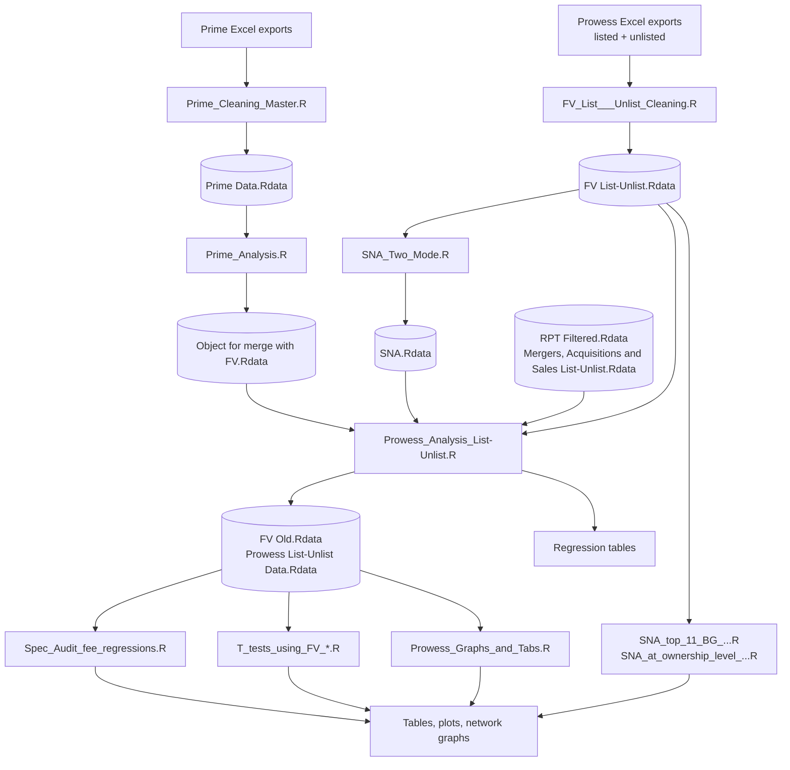

# Auditor Social Network

This repository holds the code for the **Ministry of Corporate Affairs (MCA) audit quality project**, a collaboration between the MCA and the University of Hyderabad. The project studies how the social network of auditors affects the audit of **related party transactions (RPTs)** and **audit quality** in large Indian business houses.

We built social network graphs of the auditors of all NSE 500 business groups, based on auditor rotations across firms and business alliances. The social network analysis suggests that **mandatory auditor rotation is ineffective in curbing audit fraud**: rotated auditors frequently remain inside the same business group.

---

## Contents

- [Data Sources](#data-sources)
- [Pipeline at a Glance](#pipeline-at-a-glance)
- [Repository Structure](#repository-structure)
- [Setup](#setup)
- [Run Order](#run-order)
- [Script Reference](#script-reference)
- [Sample Construction](#sample-construction)
- [Variable and Measure Definitions](#variable-and-measure-definitions)
- [Regression Specifications](#regression-specifications)
- [Outputs](#outputs)
- [Legacy Scripts](#legacy-scripts)

---

## Data Sources

- **[Prowess](https://prowessiq.cmie.com/)**: firm-level financial data compiled by the [Centre for Monitoring Indian Economy (CMIE)](https://www.cmie.com/). It is sourced from company annual reports, MCA filings and stock exchanges. It covers listed and unlisted companies, including financials, auditors and auditor fees, ownership groups, RPTs and board data.
- **[Prime Database](https://www.primedatabase.com/)**: capital market and governance data from [Prime Database Group](https://www.primedatabase.com/). It is sourced from SEBI, NSE/BSE filings and public disclosures. It covers AGM/EGM resolutions, postal ballots, director profiles, remuneration and board committees.

> The raw data is licensed and is **not** included in this repository.

---

## Pipeline at a Glance



---

## Repository Structure

Scripts sit at the repository root. They expect the data to be laid out relative to the project root as follows:

```
MCA/
├── Prowess/
│   ├── Profit/, Income/, Expenses/, ...           # Prowess Excel exports by module
│   ├── Stock Prices & Capital Changes/
│   ├── NSElist_identity_indicators.xlsx
│   ├── R Data Prowess/                            # intermediate .Rdata files
│   └── Outputs/Tables/                            # regression tables
├── Prime/
│   ├── Primedata/                                 # Prime Excel exports
│   └── Cleaned Rdata/                             # cleaned Prime / board objects
└── top_50.Rdata                                   # list of top-50 business groups
```

---

## Setup

**R packages**

```r
install.packages(c(
  "tidyverse", "readxl", "modelr", "broom", "eeptools",   # data wrangling and checks
  "igraph", "visNetwork",                                  # network analysis
  "modelsummary", "gt", "sjPlot", "plotly"                 # tables and plots
))
```

**Working directory:** set it to the project root (`MCA/`) so that relative paths such as `./Prowess/...` resolve.

---

## Run Order

| Step | Script | Reads | Writes |
|---|---|---|---|
| 1 | `FV_List___Unlist_Cleaning.R` | Prowess Excel exports | `Prowess/R Data Prowess/FV List-Unlist.Rdata` |
| 2 | `Prime_Cleaning_Master.R` | Prime Excel exports, `board_data.Rdata`, `Postal_Ballot_Data_Resolutions.Rdata`, `Director_remuneration.Rdata` | `Prime/Prime Data.Rdata` |
| 3 | `Prime_Analysis.R` | `Prime Data.Rdata` | `Prime/Object for merge with FV.Rdata` |
| 4 | `SNA_Two_Mode.R` | `FV List-Unlist.Rdata`, `top_50.Rdata` | `Prowess/R Data Prowess/SNA.Rdata` |
| 5 | `Prowess_Analysis_List-Unlist.R` | Steps 1, 3 and 4, plus `RPT Filtered.Rdata` and `Mergers, Acquisitions and Sales List-Unlist.Rdata` | `FV Old.Rdata`, `Prowess List-Unlist Data.Rdata`, regression tables |
| 6 | `Spec_Audit_fee_regressions.R` | `FV Old.Rdata`, `Prowess List-Unlist Data.Rdata` | Audit-fee regression tables |
| 6 | `T_tests_using_FV_old.R`, `T_tests_using_FV_filtered.R` | `FV Old.Rdata` / `Prowess List-Unlist Data.Rdata` | t-test tables |
| 6 | `Prowess_Graphs_and_Tabs.R` | `FV Old.Rdata`, `Prowess List-Unlist Data.Rdata` | Interactive trend plots, cross tables |
| 6 | `SNA_top_11_BG__graph_for_MCA_mid_term_meeting.R` | `FV List-Unlist.Rdata`, `top_50.Rdata` | One network HTML per top-11 group |
| 6 | `SNA_at_ownership_level_for_top_11.R` | `FV List-Unlist.Rdata` | Group–company–auditor network graph |

Step 6 scripts are independent of each other.

---

## Script Reference

### 1. `FV_List___Unlist_Cleaning.R`: build the firm-year panel (FV)

This script cleans every Prowess module for **listed** companies, repeats the process for **unlisted** companies, and appends the two.

- Each export arrives wide (`<variable><year>`). It is pivoted to long form, split into variable and year, and pivoted back to one row per `Co_name × year`.
- Modules covered: profit, income, stock prices and capital changes (EPS, P/B, adjusted close), change in stock, contingent liabilities, CSR disclosures, expenses, assets, capital, working capital, employees and branches, raw materials consumed, liabilities, directors' salary, cash flow from operations (incl. forex), auditor names and fees, promoter holding, return ratios, receivables and inventory, equity ownership, and NSE identity indicators.
- All modules are merged into `FV`, joined to the auditor list, and flagged with `unlisted = 0/1`.
- `Groupstand` (business-group membership) is filled in, and the panel's unique key `Co_name × year × Auditor_name` is checked with `eeptools::isid()`.

### 2. `Prime_Cleaning_Master.R`: clean governance data

This script cleans and renames Prime datasets:

- AGM/EGM events
- AGM/EGM resolutions (votes cast and votes in favour by promoter, institutional and other shareholders, pass/fail, RPT flag)
- Indian Boards director profiles (annual files from 2009 onward, stacked with a `year` column)
- Board committee details
- Postal ballots
- Prowess board data

### 3. `Prime_Analysis.R`: governance variables

This script builds company-year governance variables for merging into FV:

- AGM resolution and meeting-type frequencies
- Board independence (%) and female directors (%), from Prime and from Prowess board data
- **CEO duality**: a Chairperson & Managing Director on the board
- Director count and summed remuneration components (salary, sitting fees, PF, bonus, perquisites, stock options, etc.)

### 4. `SNA_Two_Mode.R`: auditor network centrality

This script builds a two-mode (bipartite) **company–auditor** network and projects it onto auditors. Two auditors are linked when they audit the same company, and the edge weight is the number of companies they share. Centrality is computed at three levels (see [Centrality](#social-network-centrality)). It then runs Welch t-tests of centrality between business-group and standalone firms, top-10 groups and other groups, and top-50 groups and other groups.

### 5. `Prowess_Analysis_List-Unlist.R`: core analysis

This is the main analytical script. It:

1. Creates the accounting, audit and group-level variables.
2. Builds auditor rotation, reappointment and specialization measures.
3. Merges governance variables, RPTs, M&A dummies and network centrality.
4. Saves the full panel as `FV Old.Rdata`, then applies the sample filters.
5. Estimates the earnings management models (Modified Jones, Roychowdhury, Vastav) and stores their residuals.
6. Runs the centrality, audit quality, auditor reappointment and audit-fee regressions.

### 6. Downstream scripts

| Script | What it does |
|---|---|
| `Spec_Audit_fee_regressions.R` | Regresses audit and non-audit fees (scaled by lagged assets) on auditor-specialization transition dummies for business-group firms, 2011–2018. It runs with and without auditor tenure and with REM interactions, and includes industry and year fixed effects. |
| `T_tests_using_FV_old.R` | Welch t-tests of centrality measures and audit counts with vs. without auditor rotation, on the **unfiltered** sample. |
| `T_tests_using_FV_filtered.R` | The same tests on the **filtered** sample. |
| `Prowess_Graphs_and_Tabs.R` | Interactive plotly and ggplot charts of auditor reappointments over time. These cover the top 11 groups, listed vs. unlisted firms, and comparisons against group RPTs, promoter holding and standardized REM. Reference lines mark 2014 and 2018. Also produces pre/post-2014 reappointment tables and GAUDSPEC cross tables. |
| `SNA_top_11_BG__graph_for_MCA_mid_term_meeting.R` | Interactive `visNetwork` graph of the projected auditor network for each of the top 11 business groups. The five auditors with the highest closeness are highlighted. Each graph is saved as `<group>.html`. |
| `SNA_at_ownership_level_for_top_11.R` | Three-level network: business group → company → auditor, with edges weighted by auditor tenure. It covers the groups above a total market-capitalisation threshold. |

---

## Sample Construction

`FV Old` is the full listed + unlisted panel. The filtered analysis sample (`FV`) keeps:

- `Indust_type == 1` firms (banks, `Indust_type == 3`, are dropped when auditors are matched to NSE indicators)
- Firms that are not in government or SBI ownership groups: Central/State Govt. commercial enterprises, State Bank of India Group, and State and Private sector are excluded
- Firms with no more than two years of missing `Sales`

Earnings management models are estimated by **2-digit NIC industry × year** cells. Only cells with **more than 10 firms** and years from **2004** onward are used. The Vastav models are also restricted to years up to 2019 and exclude NIC 45.

**Top 11 business groups:** Tata, Reliance (Mukesh Ambani), ITC, Vedanta, Aditya Birla, Hindustan Unilever, Bharti Telecom, Wipro, Larsen & Toubro, Mahindra & Mahindra, Sun Pharmaceutical.

---

## Variable and Measure Definitions

### Scaling and controls

| Variable | Definition |
|---|---|
| `*_at` | Variable scaled by lagged total assets (`Lag_Tot_assets`) |
| `One_at` | 1 / lagged total assets |
| `*_ind_mean` | Variable minus its NIC-2 × year industry mean |
| `NIC_2` | 2-digit NIC industry code |
| `Size` | log(market capitalisation) |
| `Age` | Years since incorporation |
| `LOSS` | 1 if PBDITA < 0 |
| `EQFIN` | 1 if shares outstanding rose by ≥ 10% over the previous year |
| `Invrec_at` | (Inventories + Receivables) / lagged total assets |
| `Big4` | 1 if audited by a Big 4 network firm |
| `Groupstand` | 1 if the firm belongs to a business group, 0 if standalone |
| `unlisted` | 1 for unlisted companies |
| `merger_acqui_dum` | 1 if the firm had a merger or acquisition that year |

### Audit variables

| Variable | Definition |
|---|---|
| `Audit_fees` | Statutory audit fee |
| `Non_Audit_Fee` | Taxation fees + company-law fees + consultancy fees paid to auditors |
| `Joint_Auditor` | 0 for a single auditor; 2 or 3 for the number of joint auditors |
| `Aud_tenure` | Consecutive years the auditor has audited the company |
| `GTENURE` | Mean auditor tenure within the ownership group |
| `Audit_count` | Total audits performed by an auditor across the panel |
| `Aud_rotation` | 1 if the company's auditor differs from the previous year's (lag adjusted for joint auditors) |
| `Aud_reappoint` | 1 if an auditor involved in a rotation event is also found auditing elsewhere **within the same business group**, i.e., the rotated auditor stays inside the group |
| `Time_dummy` | 0 for 2011–2014, 1 for 2015–2018 (pre/post mandatory auditor rotation under the Companies Act, 2013) |
| `Aud_elig_dummy` | 1 if tenure ≥ 10 years from 2014 onward (auditor due for mandatory rotation) |
| `Aud_Treatment` | 1 for companies whose eligible auditor was rotated during 2015–2018 |

### Auditor concentration and specialization

| Variable | Definition |
|---|---|
| `AC` | Auditor concentration: the share of a group's company-years in a year audited by that auditor |
| `AC_big4` | The same measure, with the Big 4 collapsed to their network names |
| `Audspec` | Auditor's sales share in its NIC-2 industry-year: auditor's client sales / industry sales |
| `GAUDSPEC` | 1 if `Audspec` is above the median within the ownership group-year (specialist auditor) |
| `spec_spec`, `spec_nonspec`, `nonspec_spec`, `nonspec_nonspec` | For reappointed rotations, the specialist status of the outgoing → incoming auditor |

### Group-level variables (ownership group × year)

| Variable | Definition |
|---|---|
| `GNLAF` | log(sum of audit fees) |
| `GNLNAF` | log(sum of non-audit fees) |
| `GNAFR` | Non-audit fees / total auditor fees |
| `GSIZE` | Total market capitalisation |
| `GPROMHOL` | Mean promoter shareholding |
| `GLOSS` | 1 if any group firm has PBDITA < 0 |
| `GEQFIN` | 1 if any group firm has `EQFIN = 1` |

### Related party transactions

| Variable | Definition |
|---|---|
| `GRPT` | Company-year sum of all RPT categories (revenue, capital, loans, guarantees, investments, outstanding balances, etc.) |
| `group_GRPT` | `GRPT` summed over the ownership group-year |

### Earnings management (audit quality proxies)

Each model is estimated cross-sectionally per **NIC-2 × year**. The firm's **residual** is the abnormal (discretionary) component, and a larger residual indicates lower audit quality.

**Modified Jones accruals** (`MJ_resid`, `MJ_roa_resid`)

$$\frac{Accruals}{A_{t-1}} = \beta_0\frac{1}{A_{t-1}} + \beta_1\frac{\Delta Sales - \Delta Rec}{A_{t-1}} + \beta_2\frac{PPE}{A_{t-1}} \;[+\;\beta_3 ROA_{t-1}] + \varepsilon$$

Accruals are computed from PAT and CFO (`diff(c(PAT, Cfo))`). The ROA version adds lagged ROA (Kothari et al.-style performance matching).

**Roychowdhury real earnings management** (`Roy_prod_resid`, `Roy_cfo_resid`, `Roy_disc_resid`)

| Model | Dependent | Regressors |
|---|---|---|
| Production | (COGS + ΔInventory) / A | 1/A, Sales/A, ΔSales/A, ΔSales<sub>t−1</sub>/A |
| CFO | CFO / A | 1/A, Sales/A, ΔSales/A |
| Discretionary | (Selling & distribution + travel + R&D) / A | 1/A, Sales/A |

**Vastav (augmented REM)** (`Vastav_prod_resid`, `Vastav_cfo_resid`, `Vastav_disc_resid`): the Roychowdhury regressors plus ΔSales<sub>t−1</sub>, Size, P/B, lagged ROA, ΔSales<sub>t+1</sub> and the lagged dependent variable.

**Composite REM**

- `Std_rem_roy` and `Std_rem_vastav`: the sum of the three standardized residuals
- `Std_rem_roy2`: |prod| − |CFO| − |disc|

### Social network centrality

These measures come from the auditor projection of the company–auditor bipartite graph (`igraph`).

| Measure | Network scope |
|---|---|
| `Closeness`, `Degree`, `Eigen_centrality` | Within each ownership group, all years pooled |
| `*_per_year` | Within each ownership group-year |
| `*_Mkt` | Whole market (all companies) |

- **Degree**: the number of auditors an auditor shares clients with
- **Closeness**: how few steps an auditor is from all others
- **Eigenvector centrality**: how connected an auditor is to other well-connected auditors

---

## Regression Specifications

All regressions are in `Prowess_Analysis_List-Unlist.R` unless noted. Tables are produced with `modelsummary` and report t-statistics.

| Model | Dependent variable | Key regressors | Type |
|---|---|---|---|
| Earnings management | MJ / Roy / Vastav residuals | Groupstand (or `unlisted` for groups), P/B, lagged industry-adjusted size, Big 4, promoter holding; industry and year FE | OLS |
| Centrality | Each centrality measure | Auditor rotation, Groupstand, lagged P/B, size and ROA, Big 4, promoter holding, log audit and non-audit fees | OLS |
| Audit quality | Roy residuals, MJ-ROA residual | `Time_dummy × Aud_rotation`, `Time_dummy × centrality`, controls | OLS |
| Auditor reappointment | `Aud_reappoint` | Roy / MJ residuals, `Time_dummy`, log RPTs, Groupstand, controls (plus a specialist-auditor subsample with `GAUDSPEC == 1`) | Logit |
| Audit fees (`Spec_Audit_fee_regressions.R`) | Audit fee / A, non-audit fee / A | Specialization transition dummies, tenure, LOSS, current ratio, Invrec, D/E, EQFIN, lagged P/B, size and ROA, M&A, promoter holding, age; industry and year FE | OLS |

---

## Outputs

| Output | Location |
|---|---|
| Intermediate panels | `Prowess/R Data Prowess/*.Rdata`, `Prime/*.Rdata` |
| Regression tables (HTML / DOCX) | `Prowess/Outputs/Tables/` and the working directory |
| Network graphs (HTML) | `<Business Group>.html` in the working directory |
| Plots | Interactive plotly viewers (in session) |

---

## Legacy Scripts

These scripts are earlier versions, kept for reference. They have been superseded by the pipeline above.

| Legacy script | Superseded by | Note |
|---|---|---|
| `Prowess_Cleaning.R` | `FV_List___Unlist_Cleaning.R` | Listed companies only; also contains the original RPT cleaning by party type |
| `Prime_Cleaning.R` | `Prime_Cleaning_Master.R` | Single-year board file |
| `Prowess_Analysis.R` | `Prowess_Analysis_List-Unlist.R` | Listed-only analysis |
| `SNA.R` | `SNA_Two_Mode.R` | One-mode auditor network linked by shared ownership group |
| `SNA_new.R` | `SNA_Two_Mode.R` | Directed group → company → auditor network |
| `Scrap.R` | — | Scratch work for the auditor reappointment logic |
